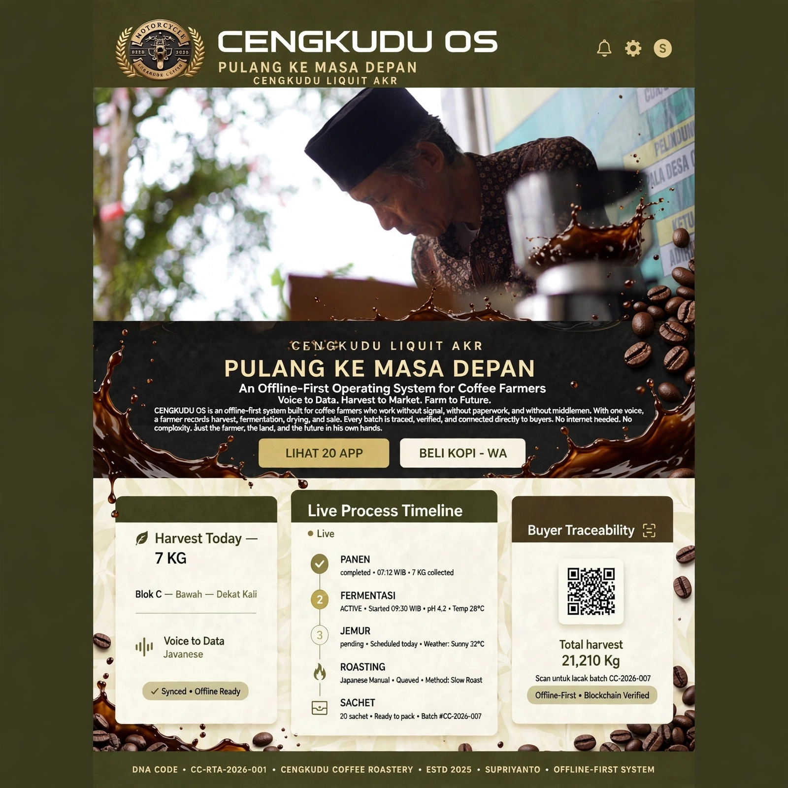

# ☕ SUPRIYANTO - CENGKUDU-OS
### PULANG KE MASA DEPAN

**Petani Kopi | Roastery | Indie Developer**
📍 Banyumas, Central Java, Indonesia - 800 Mdpl

> PANEN. JEMUR. JUAL.
> Dari kebun 800 mdpl, untuk dunia.

---

### 🌱 TENTANG GUE
Gue petani kopi dari Banyumas. Gue bangun CENGKUDU-OS, sistem buat bantu petani catat panen, jemur, sampai jual, pakai HP doang. Gak ribet.

### 🚀 PROJECT GUE
- **CENGKUDU-OS** - Sistem Manajemen Kebun Kopi
- **catat-panen-ai-2026** - Catat Panen Pakai AI

### 📫 HUBUNGI GUE
- GitHub: @Cengkudu800mdpl
- Lokasi: Banyumas, 800 Mdpl

---
*Ditanam di 800 mdpl. Dijemur matahari. Dijual ke dunia.*
